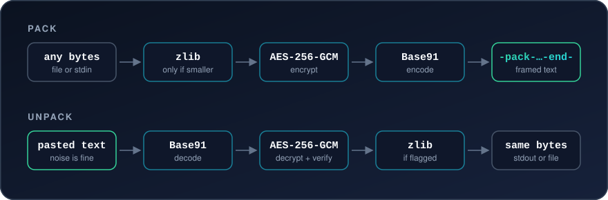

<p align="center">
  
</p>

<p align="center">
  <strong>Pack any file or stream into a block of text that survives copy/paste. Unpack it on the other side.</strong>
</p>

<p align="center">
  
  
  <a href="LICENSE"></a>
</p>

---

`pastepack` is a tiny CLI for moving bytes through places that only carry text: paste sites like PasteBin and cl1p.net, chat windows, a terminal you can only copy out of. Text, binaries, archives, anything goes in. It compresses (only when that helps), encrypts, Base91-encodes, and prints a wrapped, clearly framed block. The same tool reads that block back, even out of a messy paste.

```console
$ printf 'TypeError: invalid literal for int()' | pastepack pack
-pack-BARR0b+lvU]|~cv+5J.e~mz#d_VM~Gsm%+,frg]1V=QD?:J16l*mYp#_+s/r>^T20(k`U`CDvzkE+1q:1Nax8zvX=VJB-e
nd-

$ pastepack unpack pasted.txt
TypeError: invalid literal for int()
```

> [!WARNING]
> By default this is **obfuscation, not secrecy**: the key travels inside the payload. Set [`PASTEPACK_KEY`](#passphrase-pastepack_key) if unpacking should require a secret. See [Security model](#security-model).

## Contents

- [Install](#install)
- [Quick start](#quick-start)
- [Commands](#commands)
- [Pasting](#pasting)
- [Security model](#security-model)
- [Wire format](#wire-format)
- [Library](#library)
- [Development](#development)

## Install

Install the `pastepack` and `pp` commands as a [uv](https://docs.astral.sh/uv/) tool:

```bash
uv tool install git+https://github.com/smprather/pastepack
```

Or from a checkout:

```bash
uv tool install .   # install the commands
uv sync             # or just set up a dev environment and use `uv run pastepack`
```

Requires Python 3.12 or newer.

## Quick start

```bash
# Round trip through a pipe
pastepack pack photo.png | pastepack unpack > copy.png

# Pack a file, paste it somewhere, unpack it on the other side
pastepack pack notes.md > packed.txt
pastepack unpack packed.txt -o .        # restores ./notes.md

# Or let the shortcut work out which direction to go
pp notes.md                             # writes notes.md.pack
pp notes.md.pack                        # writes ./notes.md
```

## Commands

One executable with two subcommands, plus a shortcut:

| Command | Does |
| --- | --- |
| `pastepack pack [INPUT_FILE]` | Compress, encrypt, and encode as framed text. |
| `pastepack unpack [INPUT_FILE]` | Find the payload, then decode, decrypt, and decompress it. |
| `pp FILE` | Toggle a file between plain and packed. |

### `pack` and `unpack`

```text
pastepack pack   [INPUT_FILE] [-o FILE] [-f] [-v]
pastepack unpack [INPUT_FILE] [-o PATH] [-f] [-v]
```

Both read `INPUT_FILE`, or stdin until EOF when it is omitted or `-`, and both write to stdout unless `--output` is given.

| Option | Meaning |
| --- | --- |
| `-o`, `--output` | Write to a file instead of stdout. For `unpack`, a directory means "use the embedded filename". |
| `-f`, `--force` | Allow overwriting an existing output file. Without it, existing files are never touched. |
| `-v`, `--verbose` | Print a one-line summary to stderr, including any embedded filename. |

`pack` embeds the basename of a named input file in the payload. `unpack` never writes a file on its own; it prints to stdout unless you ask:

```bash
pastepack unpack packed.txt -o restored.md   # write to this file
pastepack unpack packed.txt -o .             # write ./<embedded filename>
pastepack unpack packed.txt -o some/dir      # write some/dir/<embedded filename>
```

Only the final component of an embedded filename is ever used, so a payload cannot write outside the directory you chose.

### `pp`

`pp FILE` does the obvious thing for a file:

- If `FILE` is packed, the original is written to `./<embedded filename>`. A file counts as packed when its name ends in `.pack` or its contents begin with `-pack-`.
- Otherwise `FILE` is packed to `FILE.pack`. If `PASTEPACK_OUTPUT_DIR` names an existing directory, the `.pack` file goes there instead of next to `FILE`.

A file that merely contains a payload somewhere, such as a saved terminal transcript, is not treated as packed; use `pastepack unpack FILE -o .` for that.

`pp` takes no options and, unlike `pack` and `unpack`, **always overwrites** existing output files.

### Environment variables

| Variable | Used by | Effect |
| --- | --- | --- |
| `PASTEPACK_KEY` | all commands | Passphrase folded into the key. Must match on both sides. |
| `PASTEPACK_OUTPUT_DIR` | `pp` | Directory for newly packed `.pack` files, if it exists. |

## Pasting

The output is built to survive rough handling:

- `pack` wraps at 100 columns.
- `unpack` only looks at what sits between the `-pack-` and `-end-` markers.
- Inside the markers, whitespace and terminal escape sequences are ignored.

So you can paste a whole terminal transcript, prompt lines and all, with the payload somewhere in the middle, and `unpack` will find it.

## Security model

This is not secure storage, and it is not trying to be.

By default each payload is self-contained: the key material needed to unpack it is carried inside the payload itself, in an obfuscated form, combined with a fixed component baked into this tool. Any copy of `pastepack` can unpack any payload it produced.

The only thing this buys you is that the output does not read as plaintext to casual eyes glancing at a terminal, a chat log, or a paste. Anyone willing to read this source, or to point a capable tool at the packed text, can recover the contents. Use it for short-lived transport convenience, not for anything that needs real key management.

### Passphrase (`PASTEPACK_KEY`)

Set the `PASTEPACK_KEY` environment variable to fold a passphrase into the key. When set, it must match on both sides:

```bash
PASTEPACK_KEY=swordfish pastepack pack message.txt | PASTEPACK_KEY=swordfish pastepack unpack
```

This moves a secret out of the source entirely, so the payload cannot be unpacked without it. The key is derived with scrypt, salted per message, which slows down guessing, but a weak passphrase is still a weak passphrase. Leave `PASTEPACK_KEY` unset and the tool behaves as above: self-contained, obfuscation only.

## Wire format



```text
-pack-<Base91 text>-end-
```

The Base91 text decodes to:

| Bytes | Content |
| --- | --- |
| 1 | format version (currently `1`) |
| 1 | flags: `0x01` zlib-compressed, `0x02` filename embedded |
| 12 | random AES-GCM nonce |
| rest | AES-256-GCM ciphertext and tag; the two header bytes are authenticated |

The decrypted bytes are optionally zlib-compressed, and optionally start with a 2-byte length and a UTF-8 basename. `-` is not a Base91 character, so the markers cannot appear inside a payload.

**Compression.** `pack` tries zlib. If that makes the payload smaller, it stores the compressed bytes; otherwise it encrypts the raw bytes.

## Library

```python
from pastepack import pack, unpack

text = pack(b"hello", filename="hello.txt", passphrase="")
result = unpack(text)  # Unpacked(data=b"hello", filename="hello.txt", compressed=False)
```

`unpack` raises `PackError` when the text holds no payload it can read.

## Development

```bash
uv sync           # create the virtual environment
uv run pytest -q  # run the tests
```

| Path | What lives there |
| --- | --- |
| `src/pastepack/cli.py` | The `pastepack` command group and the `pp` shortcut. |
| `src/pastepack/codec.py` | Pack/unpack pipeline and wire format. |
| `tests/` | Codec and CLI tests. |

## License

[MIT](LICENSE)
